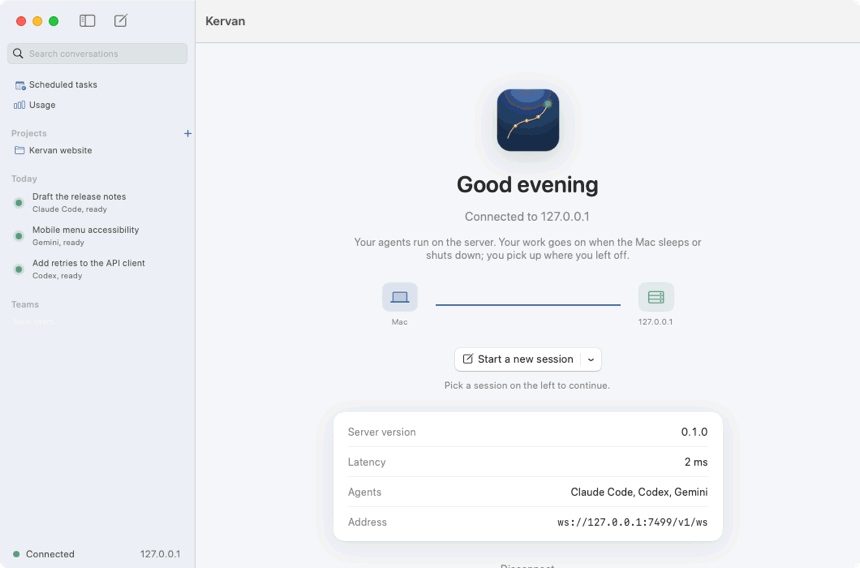
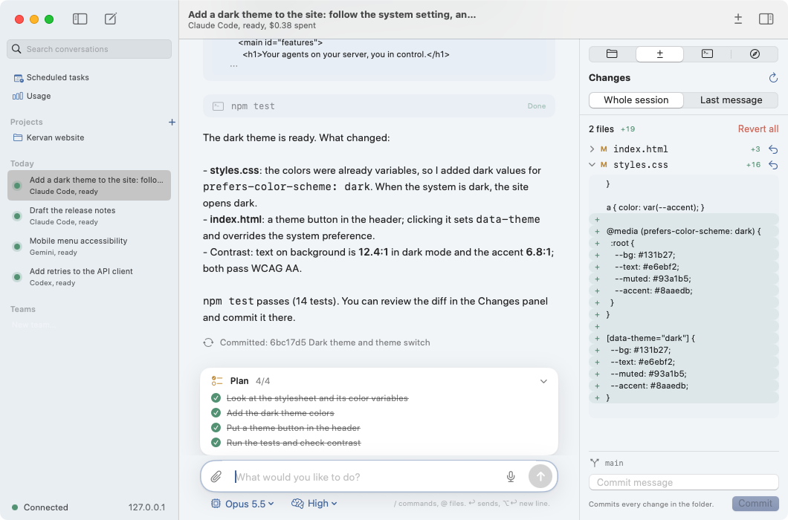
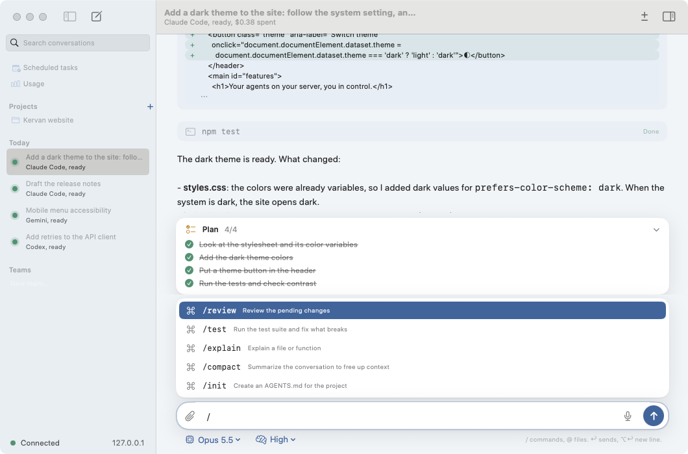
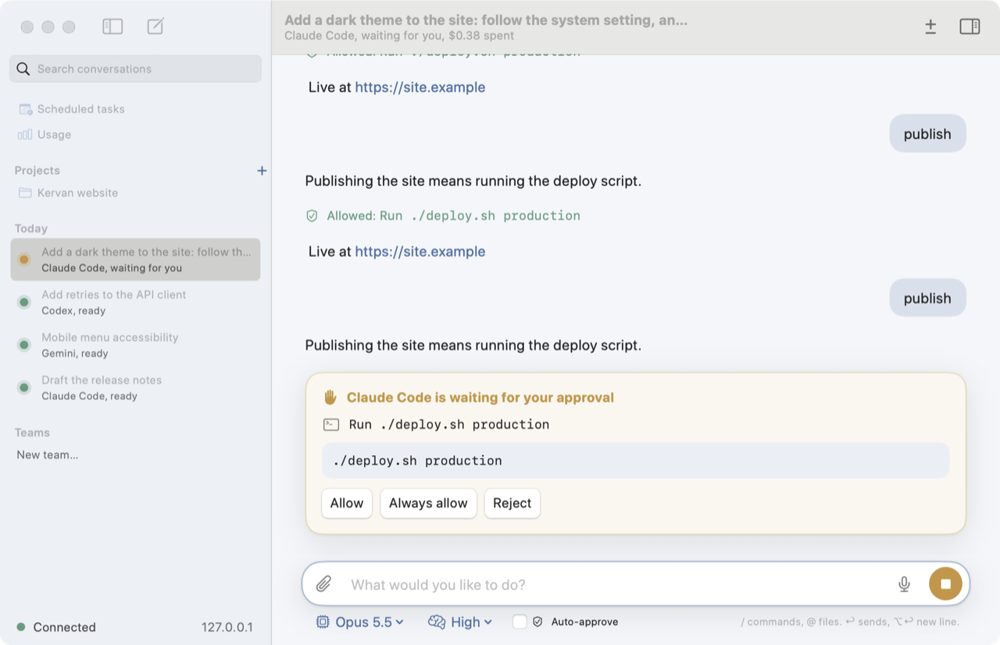
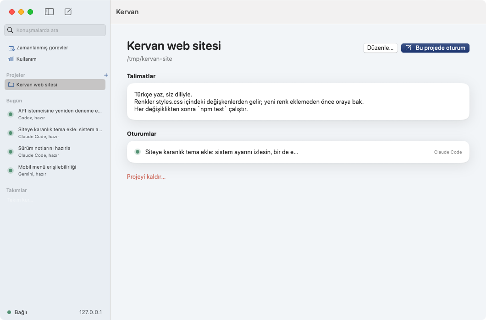
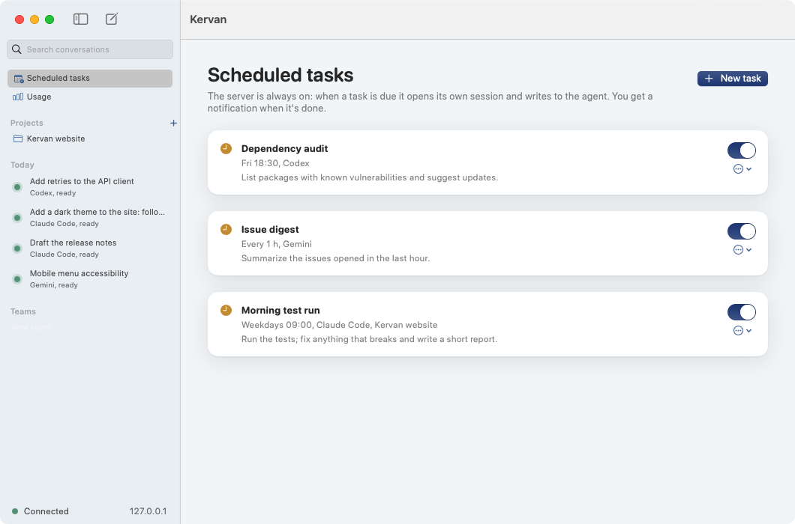
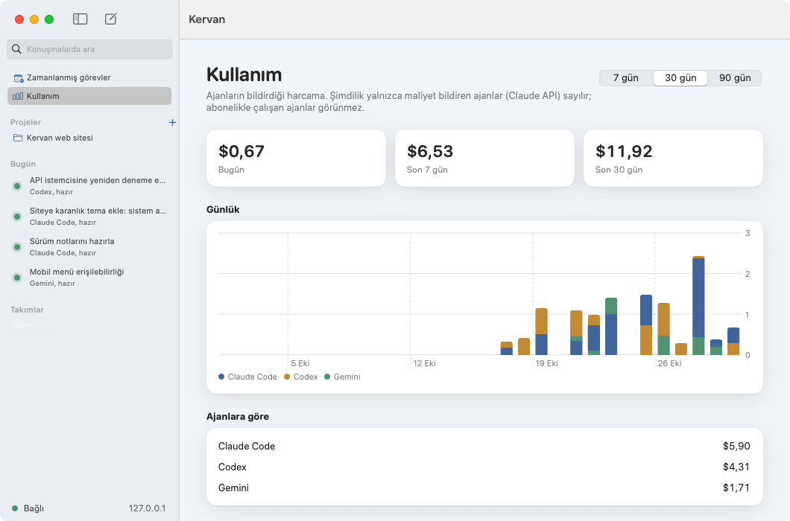
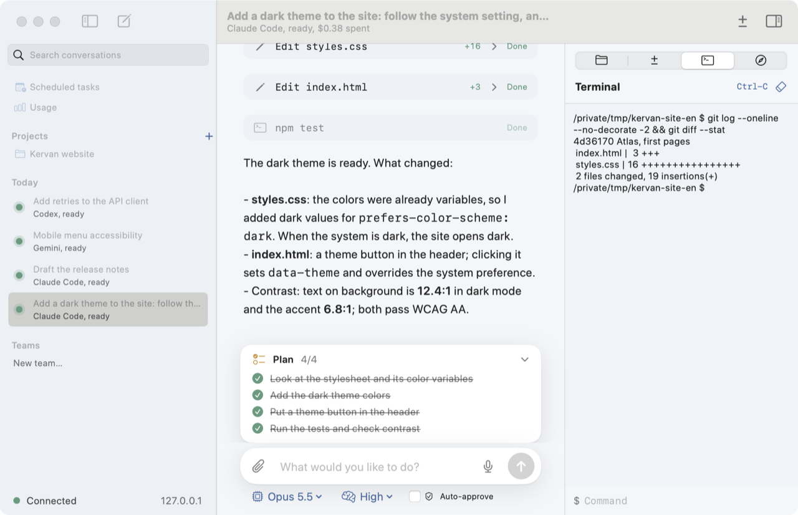
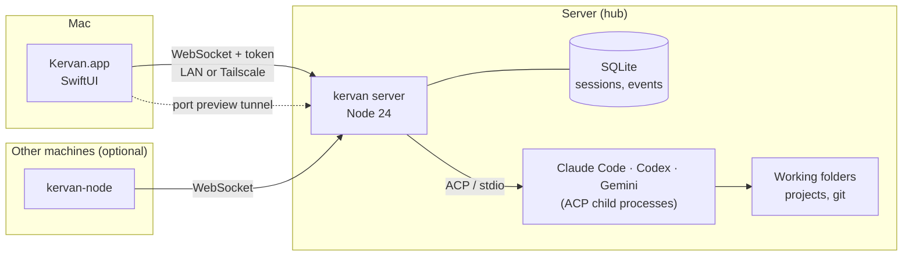
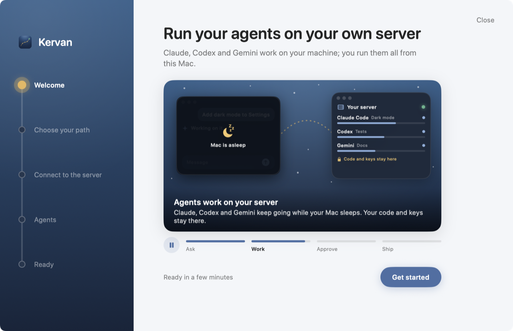

<div align="center">


# Kervan

**English** · [Türkçe](README.tr.md)

**Run your coding agents on your own server. Drive them all from your Mac.**

A server that runs Claude Code, Codex and Gemini on a Linux machine at home or in the cloud,
and a native macOS app that manages them from one place.
Work goes on while your Mac sleeps; when you come back, you pick up where the agents are.


[](https://github.com/enesyaks/Kervan/actions/workflows/ci.yml)
[](LICENSE)
[](https://github.com/enesyaks/Kervan/releases/latest)



<sub>A project session: the agent shares its plan, edits files and runs the tests; the diff sits in the side panel, one click to commit.</sub>

</div>

---

## Contents

- [Why Kervan](#why-kervan)
- [Features](#features)
- [How it works](#how-it-works)
- [Installation](#installation)
- [Agents and keys](#agents-and-keys)
- [Security](#security)
- [Development](#development)
- [Project layout](#project-layout)
- [Contributing and license](#contributing-and-license)

## Why Kervan

Coding agents work for hours on long tasks. On a laptop, the lid closes, the Wi-Fi changes, the battery dies
and the turn is cut off. Kervan moves the agents to a machine that is always on and keeps the controls on your Mac:

- **Work keeps going.** Agents run on the server; a turn continues even when the Mac disconnects, and the
  history streams back when it reconnects.
- **All in one place.** Claude Code, Codex and Gemini in the same app, the same project, even the same team.
- **Everything stays yours.** Code, session history and API keys stay on your machine; keys never reach the Mac.
- **Set up in minutes.** The app installs the server on a fresh Ubuntu machine over SSH by itself.

## Features

<table>
<tr>
<td width="50%" valign="top">

### See changes, undo them, commit them
Every edit the agent makes opens as a line-by-line diff in the chat. The **Changes** panel lists the files
changed since the session's first or last message; revert one file or all of them, and commit from there
when the folder is a git repository. Kervan snapshots the folder before every message in a store of its own,
so your git history is never touched.

</td>
<td width="50%"></td>
</tr>
<tr>
<td></td>
<td valign="top">

### Plan, commands, files
As the agent shares its to-do list, a **plan card** fills in above the composer. Type `/` for the agent's own
commands (`/review`, `/compact`…) or `@` for files in the folder; a picked file is attached to the message.
Paste a screenshot with **⌘V** and it reaches agents that see images as an image; the mic button starts
macOS dictation.

</td>
</tr>
<tr>
<td valign="top">

### You stay in control
Before running a command or deleting a file, the agent stops and **waits for your approval**; the Dock icon
and a notification tell you. You can **edit and resend** a message, or **rewind** the folder to before any
message. The conversation stays, and the agent is told what happened.

</td>
<td></td>
</tr>
<tr>
<td></td>
<td valign="top">

### Projects
Make a project from a folder on the server, a git repository the server clones, or a new empty folder. The
project's **instructions** (code style, test command, things to watch out for) are given to every agent in
it before its first message, and its sessions share the folder.

</td>
</tr>
<tr>
<td valign="top">

### Scheduled tasks
"Run the tests at 09:00 on weekdays and fix what breaks" or "summarize new issues every hour". The server is
always on, so when a task is due it opens a session of its own and writes to the agent; you get a
notification when it's done. Times follow your Mac's time zone.

</td>
<td></td>
</tr>
<tr>
<td></td>
<td valign="top">

### Usage and budgets
See what was spent today and over the last 7 and 30 days, by agent and by session. Give a lead agent and its
helpers a shared **budget**; when it runs out, they all stop.

</td>
</tr>
<tr>
<td valign="top">

### Terminal and preview
The side panel's **Terminal** opens a shell in the session's folder on the server. **Preview** opens a dev
server the agent started there (say `:3000`) as `localhost` on your Mac, even when that port isn't open to
the network.

</td>
<td></td>
</tr>
</table>

### From your phone, in the browser

The server can also serve a web version of Kervan at its own address, `http://<server>:7420`, for your phone or
any computer that reaches the server (the same network or Tailscale). It's off until you turn it on in
**Settings › Web access**. There, **Add a device** shows a one-time code; open the address in the browser and enter
it. That browser gets a key of its own: it can follow sessions, answer approvals, send messages, stop a turn and
start new sessions, but not change settings, agents, nodes or files. Lost the phone? Remove it in the same place
and its access ends at once. On a phone, **Add to Home Screen** makes it open like an app.

### And more

| | |
|---|---|
| **Two languages** | The app speaks English and Turkish; pick one in **Settings › General › Language**. By default it follows macOS. |
| **Teams and roles** | Split a job across several agents, each role with its own agent, instructions, skills and MCP servers. The team view shows them side by side. |
| **Orchestration** | A lead agent hands subtasks to helper agents; in a git repository each helper works on its own branch, and the lead reviews the diff and merges it. |
| **Skills and MCP** | A skill library and MCP servers live on the server and are switched on per session or role, so every agent gets the same tools. |
| **Nodes** | Run agents on other machines too (a GPU box, say); the hub brings them all into one app. |
| **Model picker** | The agent's models, thinking level and modes sit under the composer. |
| **Search and archive** | Full-text search across every conversation; archive old sessions. |
| **Pull requests** | From the Changes panel, push a session's work on its own branch and open a pull request (with `gh` signed in on the server as the service user: `sudo -u kervan -H gh auth login`, then `sudo -u kervan -H gh auth setup-git`; otherwise GitHub opens with it ready). |
| **Resilience** | Every event is written to SQLite first. If the server restarts, sessions are recovered and the agent continues the conversation where it left off. |

## How it works



- **The server** runs agents as child processes over the [Agent Client Protocol](https://agentclientprotocol.com).
  Everything they produce (messages, thinking, tool calls, diffs, plans, approval requests) becomes agent-neutral
  events that are written to SQLite and broadcast to every connected client.
- **The Mac app** talks over a single WebSocket; the protocol is in [`protocol/v1.md`](protocol/v1.md).
  File uploads and downloads go over HTTP with the same token.
- **Checkpoints** copy the session folder into a separate git store in Kervan's data folder before every
  message. The Changes panel and rewinding are built on them.
- A **PTY fallback** covers command-line agents without ACP: the agent runs in a pseudo-terminal and answers in plain text.

## Installation

### 1. The app

Download the app from the [latest release](https://github.com/enesyaks/Kervan/releases/latest). It isn't notarized
by Apple yet, so macOS blocks it the first time you open it. Open it once, then go to **System Settings → Privacy &
Security** and click **Open Anyway** (on macOS 14, right-click → Open in Finder also works). After that it opens
normally, and later versions install from inside the app. To build it from source:

```bash
git clone https://github.com/enesyaks/Kervan.git
cd Kervan/mac
scripts/bundle.sh          # mac/build/Kervan.app
open build/Kervan.app
```

There is no Xcode project; the Swift package builds with the Command Line Tools. macOS 14 or later.

### 2. The server

On first launch the app walks you through it:



- **I have a Kervan server:** enter its address (`192.168.1.21` or a Tailscale name) and the access key.
- **Set one up together:** give the address of a fresh Ubuntu 24.04 machine you can reach over SSH. The app
  installs the server, the systemd service and the agents; you choose access from the local network,
  Tailscale or both. If `sudo` needs a password, it prepares the command for you to run in your own Terminal.

To install by hand:

```bash
scp -r infra <user>@<server>:~/
ssh -t <user>@<server> 'sudo bash ~/infra/vm-setup.sh'
infra/deploy.sh <user>@<server>          # sends the code and restarts the service
curl http://<server>:7420/health
```

The access key is `KERVAN_TOKEN` in `/etc/kervan/env` on the server.

| On the server | What's there |
|---|---|
| `/opt/kervan/server` | The code |
| `/etc/kervan/env` | Environment: `KERVAN_TOKEN`, `KERVAN_HOST`, `KERVAN_PORT`, `KERVAN_DATA_DIR` |
| `/var/lib/kervan/kervan.db` | SQLite: sessions, events, usage log (backed up daily) |
| `/var/lib/kervan/checkpoints` | A checkpoint store per session |
| `/srv/kervan/workspaces` | Session folders; new and cloned projects under `projects/` |

The service runs with systemd's `ProtectSystem=strict`: agents can only write under `/srv/kervan`,
`/var/lib/kervan` and `/home/kervan`. To make an existing folder a project, put it under one of those.

Logs: `journalctl -u kervan -f`

## Agents and keys

The server ships with adapters for Claude Code, Codex and Gemini. Give each one its key in the **Agents** step
of the first launch, or later in **Settings › Agents**:

| Agent | Key | Alternative |
|---|---|---|
| Claude Code | `ANTHROPIC_API_KEY` | With a Claude subscription: run `claude setup-token` on your Mac and paste the token |
| Codex | `OPENAI_API_KEY` | |
| Gemini | `GEMINI_API_KEY` | Has a free tier |

The key is saved on the server as the agent's own environment; it isn't stored on the Mac and is never sent
back to the app. Other ACP agents or command-line tools can be added with an `agents.yaml`
([example](infra/agents.example.yaml)) or from the app.

## Security

- The server accepts only connections with the **token**; with a wrong one it answers `401` before any WebSocket opens.
- It's designed for your local network or **Tailscale**; don't expose it to the internet.
- API keys and MCP secrets stay on the server in files with `0600` permissions; clients only see their names.
- Tool calls that need approval wait until you answer.
- The port preview tunnel needs the same token and only connects to the server's own `localhost`.
- The web version is off by default. A browser is paired with a one-time code (valid ten minutes) and gets its own
  key, stored hashed on the server and revocable from the app; the server's key never reaches a browser. Paired
  browsers can only work with sessions. After ten failed tries an address waits ten minutes. The page is served
  with a strict content security policy.
- Nodes join with a single-use invite code; a node's token can't use the app's API.

See [SECURITY.md](SECURITY.md) for how to report a vulnerability.

## Development

```bash
# Server
cd server
npm install
npm test                     # 125 tests
npm run dev                  # ws://127.0.0.1:7420/v1/ws, token: local-dev-token-not-secret

# Mac
cd mac
swift test                   # 86 tests
KERVAN_SERVER=localhost KERVAN_TOKEN=local-dev-token-not-secret swift run Kervan
```

To work on the UI without spending a real agent's quota: `node server/scripts/dev-fake-server.ts`.

Useful environment variables for the app: `KERVAN_SERVER`, `KERVAN_TOKEN` (skips the Keychain),
`KERVAN_NO_INTRO=1` (no opening animation), `KERVAN_ONBOARDING=1` (show the first-launch flow again).

UI text lives next to its translation: `L("English", "Türkçe")` in [`Localization.swift`](mac/Sources/KervanKit/Localization.swift).

### Regenerating the screenshots

The screenshots and the recording on this page were made with a scripted demo agent that calls no model
([`server/scripts/demo-agent.ts`](server/scripts/demo-agent.ts)). Give it to a server with an `agents.yaml`:

```yaml
agents:
  claude:
    name: Claude Code
    command: node
    args: ["/full/path/to/Kervan/server/scripts/demo-agent.ts"]   # agents start in the session folder, so use a full path
```

Make a project from a folder with `styles.css` and `index.html` in it and ask for a dark theme; ask it to
"publish" and it asks for approval. Add `env: { DEMO_LANG: tr }` for a Turkish agent.

## Project layout

```
mac/        SwiftUI app and KervanKit (protocol, session store, transcript, localization)
server/     Server: sessions, ACP runner, checkpoints, projects, scheduler, tunnel
protocol/   Mac ↔ server message schema (v1.md)
infra/      Server setup, systemd service, deploy
docs/       Roadmap and media
```

Roadmap: [`docs/ROADMAP.md`](docs/ROADMAP.md).

## Contributing and license

Bug reports, ideas and pull requests are welcome; [CONTRIBUTING.md](CONTRIBUTING.md) explains how to start.

Kervan is released under the [MIT license](LICENSE).
