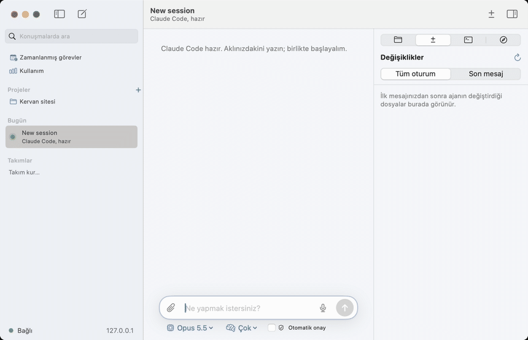
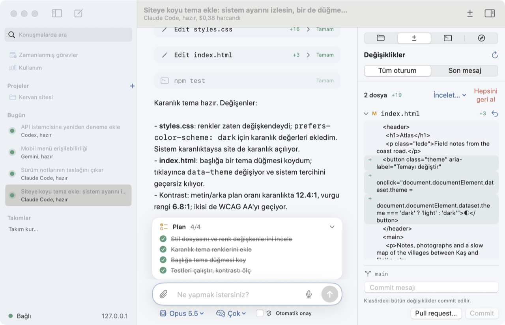
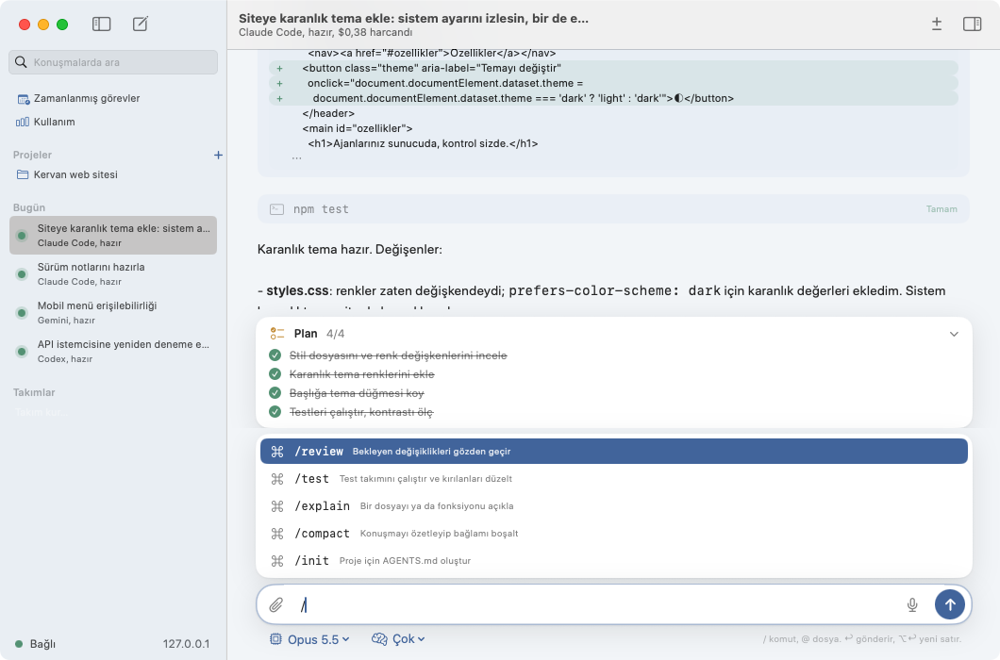
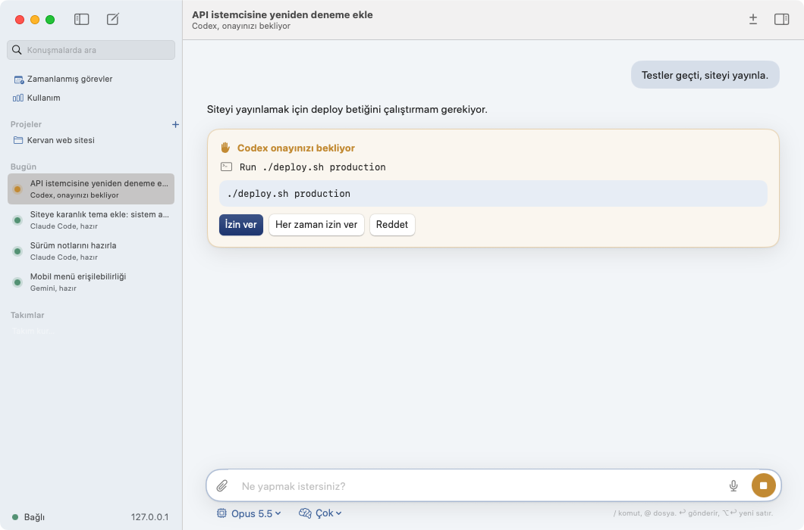
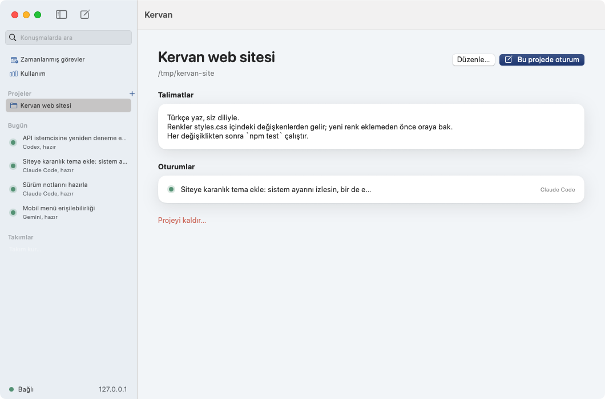
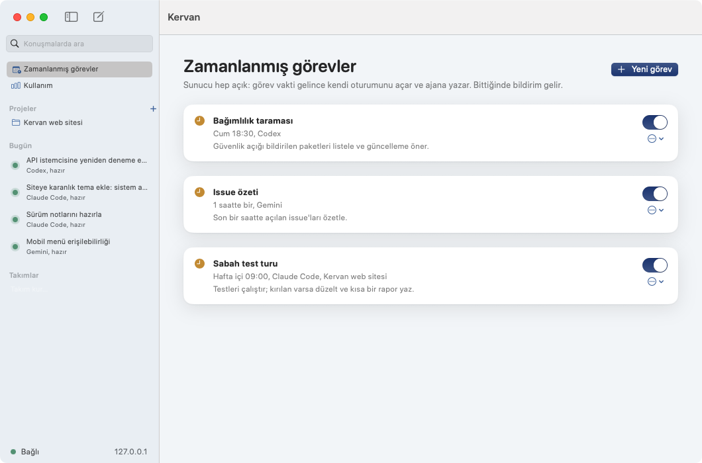
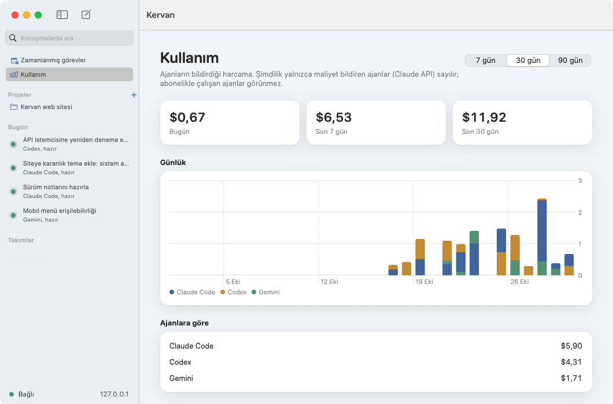
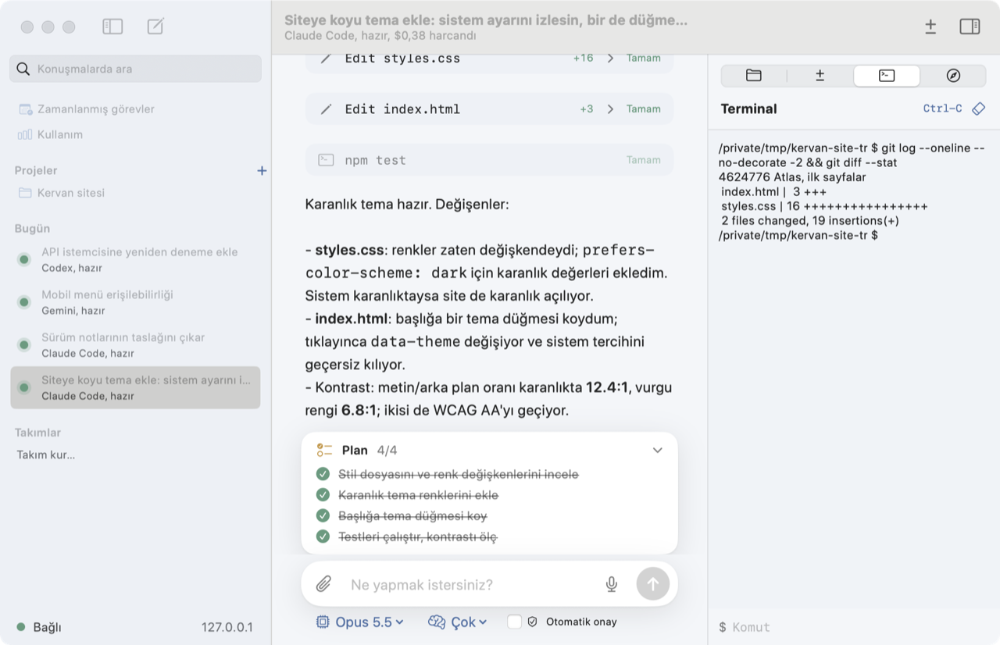
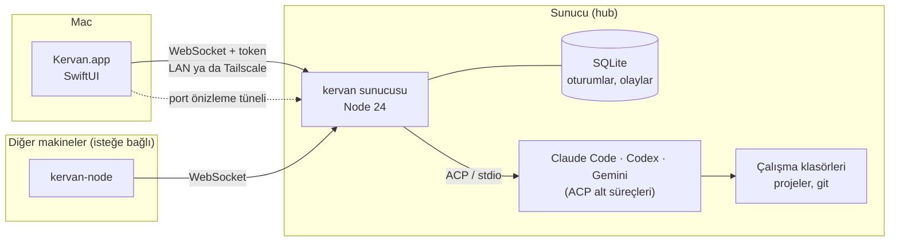
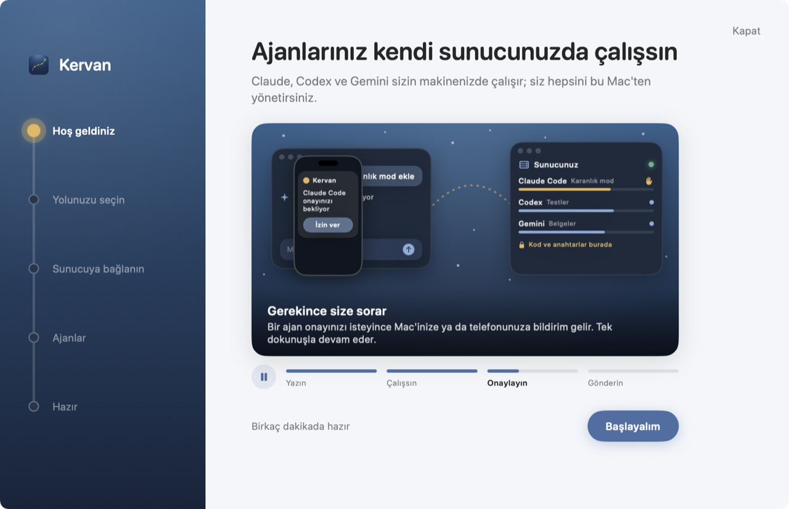

<div align="center">


# Kervan

[English](README.md) · **Türkçe**

**Kodlama ajanlarınız kendi sunucunuzda çalışsın, siz hepsini Mac'ten yönetin.**

Claude Code, Codex ve Gemini'yi evdeki ya da buluttaki bir Linux makinede çalıştıran bir sunucu
ve onları tek bir yerden yöneten native bir macOS uygulaması.
Mac uyusa da kapansa da iş sürer; döndüğünüzde kaldığı yerden görürsünüz.


[](https://github.com/enesyaks/Kervan/actions/workflows/ci.yml)
[](LICENSE)
[](https://github.com/enesyaks/Kervan/releases/latest)



<sub>Bir proje oturumu: ajan planını paylaşır, dosyaları düzenler, testleri çalıştırır; fark yan panelde, commit tek tıkta.</sub>

</div>

---

## İçindekiler

- [Neden Kervan](#neden-kervan)
- [Özellikler](#özellikler)
- [Nasıl çalışır](#nasıl-çalışır)
- [Kurulum](#kurulum)
- [Ajanlar ve anahtarlar](#ajanlar-ve-anahtarlar)
- [Güvenlik](#güvenlik)
- [Geliştirme](#geliştirme)
- [Proje yapısı](#proje-yapısı)
- [Katkı ve lisans](#katkı-ve-lisans)

## Neden Kervan

Kodlama ajanları uzun işlerde saatlerce çalışır. Bunu dizüstünde yapınca kapak kapanır, Wi-Fi değişir,
pil biter ve tur yarıda kalır. Kervan ajanları her zaman açık bir makineye taşır, kontrolü Mac'te bırakır:

- **İş sürer.** Ajanlar sunucuda çalışır; Mac bağlantısı koptuğunda bile tur devam eder, bağlanınca geçmiş akar.
- **Hepsi bir arada.** Claude Code, Codex ve Gemini aynı arayüzde, aynı projede, gerekirse aynı takımda.
- **Her şey sizde.** Kod, oturum geçmişi ve API anahtarları kendi makinenizde durur; anahtarlar Mac'e hiç gelmez.
- **Kurulum dakikalar sürer.** Uygulama boş bir Ubuntu makinesine SSH ile sunucuyu kendisi kurar.

## Özellikler

<table>
<tr>
<td width="50%" valign="top">

### Değişiklikleri görün, geri alın, commit edin
Ajanın her düzenlemesi sohbette satır satır fark olarak açılır. **Değişiklikler** paneli oturumun ilk ya da
son mesajından bu yana değişen dosyaları listeler; bir dosyayı ya da hepsini geri alırsınız, klasör bir git
deposuysa oradan commit edersiniz. Kervan her mesajdan önce klasörün kopyasını kendi deposunda tutar;
sizin git geçmişinize dokunmaz.

</td>
<td width="50%"></td>
</tr>
<tr>
<td></td>
<td valign="top">

### Plan, komutlar, dosyalar
Ajan yapılacaklar listesini paylaştıkça yazma kutusunun üstünde **plan kartı** ilerler. `/` yazınca ajanın
kendi komutları (`/review`, `/compact`…), `@` yazınca klasördeki dosyalar önerilir; seçilen dosya mesaja
eklenir. **⌘V** ile ekran görüntüsü yapıştırırsınız, resim görebilen ajana resim olarak gider;
mikrofon düğmesi macOS diktesini başlatır.

</td>
</tr>
<tr>
<td valign="top">

### Kontrol sizde
Komut çalıştırmak ya da dosya silmek gibi işlerde ajan durur ve **onayınızı bekler**; Dock simgesi ve
bildirim haber verir. Bir mesajı **düzenleyip yeniden gönderebilir** ya da klasörü o mesajdan **önceye geri
sarabilirsiniz**. Konuşma silinmez, ajana olan biten söylenir.

</td>
<td></td>
</tr>
<tr>
<td></td>
<td valign="top">

### Projeler
Sunucudaki bir klasörü, sunucunun klonladığı bir git deposunu ya da boş bir klasörü proje yapın. Projenin
**talimatları** (kod stili, test komutu, dikkat edilecekler) o projedeki her ajana ilk mesajdan önce
söylenir. Git deposunda her oturum kendi branch'inde (bir worktree'de) çalışır; böylece birkaç ajan aynı projede,
birbirinin dosyalarına dokunmadan aynı anda çalışabilir.

</td>
</tr>
<tr>
<td valign="top">

### Zamanlanmış görevler
"Hafta içi 09:00'da testleri çalıştır, kırılanı düzelt" ya da "her saat yeni issue'ları özetle".
Sunucu her zaman açık olduğu için görev vakti gelince kendi oturumunu açar ve ajana yazar; bittiğinde
bildirim gelir. Saatler Mac'inizin saat diliminde.

</td>
<td></td>
</tr>
<tr>
<td></td>
<td valign="top">

### Kullanım ve bütçe
Bugün, son 7 ve 30 günde ne harcandığını, ajanlara ve oturumlara göre dağılımı görün. Ana ajan ile
yardımcılarına toplam **bütçe** koyabilirsiniz; dolunca hepsi durur.

</td>
</tr>
<tr>
<td valign="top">

### Terminal ve önizleme
Yan paneldeki **Terminal**, oturumun klasöründe sunucuda bir kabuk açar. **Önizleme**, ajanın sunucuda
başlattığı geliştirme sunucusunu (ör. `:3000`) bu Mac'te `localhost` olarak açar; sunucunun portu dışarı
açık olmasa da çalışır.

</td>
<td></td>
</tr>
</table>

### Telefondan, tarayıcıda

Sunucu kendi adresinde Kervan'ın web sürümünü de sunabilir: `http://<sunucu>:7420`; telefonunuz ya da sunucuya
erişebilen herhangi bir bilgisayar için (aynı ağ ya da Tailscale). **Ayarlar › Web erişimi**'nden açana kadar
kapalıdır. Orada **Cihaz ekle** tek kullanımlık bir kod gösterir; adresi tarayıcıda açıp kodu girin. O tarayıcıya
kendine ait bir anahtar verilir: oturumları izleyebilir, onay verebilir, mesaj gönderebilir, durdurabilir ve yeni
oturum başlatabilir; ama ayarları, ajanları, node'ları ya da dosyaları değiştiremez. Telefon kaybolursa aynı yerden
kaldırın, erişimi anında biter. Telefonda **Ana Ekrana Ekle** ile uygulama gibi açılır.

### Ve dahası

| | |
|---|---|
| **İki dil** | Uygulama İngilizce ve Türkçe; **Ayarlar › Genel › Dil**'den seçilir, varsayılan olarak macOS'un dilini izler. |
| **Takımlar ve roller** | Bir işi birkaç ajana bölün: her rolün ajanı, talimatı, skill ve MCP sunucuları ayrı. Takım görünümü hepsini yan yana gösterir. |
| **Orkestrasyon** | Ana ajan alt görevleri yardımcı ajanlara verir; git deposunda her yardımcı kendi dalında çalışır, ana ajan farkına bakıp birleştirir. |
| **Skill ve MCP** | Skill kütüphanesi ve MCP sunucuları sunucuda tutulur, oturum ya da rol başına açılır; her ajan aynı araçları kullanır. |
| **Node'lar** | Ajanları başka makinelerde de çalıştırın (ör. GPU'lu bir kutu); hub hepsini tek uygulamada toplar. |
| **Model seçici** | Ajanın sunduğu model, düşünme seviyesi ve mod yazma kutusunun altında. |
| **Arama ve arşiv** | Bütün konuşmalarda tam metin arama; eski oturumları arşivleyin. |
| **Görev panosu** | Her projenin bir panosu var: kartlar bir istem taşır, birini Çalışıyor'a sürükleyince oturum başlar; kart oturum ilerledikçe kendiliğinden Sizi bekliyor, İncelenecek ve Bitti'ye geçer. Web sürümü aynı panoyu gösterir. |
| **Pull request** | Değişiklikler panelinden oturumun işini kendi branch'inde push edip pull request açın (sunucuyu bir kez **Ayarlar › Genel › GitHub**'dan GitHub'a bağlayın: bir kod gösterir, tarayıcınızda onaylarsınız; bağlı değilse GitHub, pull request hazır hâliyle açılır). |
| **Dayanıklılık** | Her olay önce SQLite'a yazılır. Sunucu yeniden başlarsa oturumlar kurtarılır, ajan konuşmaya kaldığı yerden devam eder. |

## Nasıl çalışır



- **Sunucu** ajanları [Agent Client Protocol](https://agentclientprotocol.com) üzerinden alt süreç olarak çalıştırır.
  Ajanların ürettiği her şey (mesaj, düşünme, araç çağrısı, fark, plan, izin isteği) ajandan bağımsız olaylara
  çevrilir, SQLite'a yazılır ve bağlı bütün istemcilere yayınlanır.
- **Mac uygulaması** tek bir WebSocket üzerinden konuşur; protokol [`protocol/v1.md`](protocol/v1.md) dosyasında.
  Dosya yükleme ve indirme aynı token'la HTTP üzerinden yapılır.
- **Checkpoint'ler** her mesajdan önce oturum klasörünün kopyasını Kervan'ın veri klasöründeki ayrı bir git
  deposuna alır. Değişiklikler paneli ve geri sarma bunun üzerine kurulu.
- ACP konuşmayan komut satırı ajanları için bir **PTY yedeği** var: ajan sahte bir terminalde çalışır, cevabı düz metin olur.

## Kurulum

### 1. Uygulama

Hazır derlenmiş uygulamayı [son sürümden](https://github.com/enesyaks/Kervan/releases/latest) indirebilirsiniz.
Uygulama henüz Apple tarafından onaylanmadığı (notarize edilmediği) için macOS ilk açılışta engeller. Bir kez açmayı
deneyin, sonra **Sistem Ayarları → Gizlilik ve Güvenlik** bölümünde **Yine de Aç**'a tıklayın (macOS 14'te Finder'da
sağ tık → Aç da olur). Sonrasında normal açılır; yeni sürümler uygulamanın içinden kurulur.
Kaynaktan derlemek için:

```bash
git clone https://github.com/enesyaks/Kervan.git
cd Kervan/mac
scripts/bundle.sh          # mac/build/Kervan.app
open build/Kervan.app
```

Xcode projesi yok; Swift paketi Command Line Tools ile derlenir. macOS 14 ve üstü.

### 2. Sunucu

İlk açılışta uygulama sizi adım adım götürür:



- **Sunucum var:** adresi (`192.168.1.21` ya da Tailscale adı) ve erişim anahtarını girin.
- **Kurmam lazım:** SSH ile erişebildiğiniz boş bir Ubuntu 24.04 makinesinin adresini verin.
  Uygulama sunucuyu, systemd servisini ve ajanları kurar; yerel ağ, Tailscale ya da ikisinden erişimi seçersiniz.
  `sudo` parola isterse komutu kendi Terminal'inizde çalıştırmanız için hazırlar.

Elle kurmak isterseniz:

```bash
scp -r infra <kullanıcı>@<sunucu>:~/
ssh -t <kullanıcı>@<sunucu> 'sudo bash ~/infra/vm-setup.sh'
infra/deploy.sh <kullanıcı>@<sunucu>          # kodu gönderir, servisi yeniden başlatır
curl http://<sunucu>:7420/health
```

Erişim anahtarı sunucuda `/etc/kervan/env` içinde (`KERVAN_TOKEN`).

| Sunucuda | İçerik |
|---|---|
| `/opt/kervan/server` | Uygulama kodu |
| `/etc/kervan/env` | Ortam değişkenleri: `KERVAN_TOKEN`, `KERVAN_HOST`, `KERVAN_PORT`, `KERVAN_DATA_DIR` |
| `/var/lib/kervan/kervan.db` | SQLite: oturumlar, olaylar, kullanım kaydı (günlük yedekli) |
| `/var/lib/kervan/checkpoints` | Oturum başına checkpoint depoları |
| `/srv/kervan/workspaces` | Oturum klasörleri; yeni ve klonlanan projeler `projects/` altında |

Servis systemd'nin `ProtectSystem=strict` korumasıyla çalışır: ajanlar yalnızca `/srv/kervan`,
`/var/lib/kervan` ve `/home/kervan` altına yazabilir. Var olan bir klasörü proje yapacaksanız onu bu yollardan
birine koyun.

Loglar: `journalctl -u kervan -f`

## Ajanlar ve anahtarlar

Sunucu Claude Code, Codex ve Gemini adaptörleriyle gelir. İlk açılışın **Ajanlar** adımında ya da
**Ayarlar → Ajanlar**'da her birine anahtar verirsiniz:

| Ajan | Anahtar | Alternatif |
|---|---|---|
| Claude Code | `ANTHROPIC_API_KEY` | Claude aboneliği: Mac'te `claude setup-token` çalıştırıp jetonu yapıştırın |
| Codex | `OPENAI_API_KEY` | |
| Gemini | `GEMINI_API_KEY` | Ücretsiz kotası var |

Anahtar sunucuya ajanın kendi ortamı olarak kaydedilir; Mac'te saklanmaz, uygulamaya geri gönderilmez.
Başka ACP ajanları ya da komut satırı araçları `agents.yaml` ile ([örnek](infra/agents.example.yaml)) veya
uygulamadan eklenebilir.

## Güvenlik

- Sunucu yalnızca **token'lı** bağlantı kabul eder; token yanlışsa WebSocket açılmadan `401` döner.
- Tasarım gereği yerel ağ ya da **Tailscale** içinde çalışır; internete açmayın.
- API anahtarları ve MCP sırları sunucuda `0600` izinli dosyalarda durur; istemciye yalnızca adları gider.
- İzin isteyen araç çağrıları siz onaylayana kadar bekler.
- Port önizleme tüneli de aynı token'ı ister ve yalnızca sunucunun kendi `localhost`'una bağlanır.
- Web sürümü varsayılan olarak kapalıdır. Tarayıcı tek kullanımlık bir kodla (on dakika geçerli) eşleştirilir ve
  kendine ait bir anahtar alır; anahtar sunucuda hash'lenmiş olarak durur ve uygulamadan iptal edilebilir. Sunucunun
  anahtarı hiçbir tarayıcıya gitmez. Eşleştirilen tarayıcılar yalnızca oturumlarla çalışabilir. On başarısız
  denemeden sonra o adres on dakika bekler. Sayfa sıkı bir içerik güvenlik politikasıyla sunulur.
- Node'lar kendi tek kullanımlık davet koduyla katılır; node token'ı uygulamanın API'sini kullanamaz.

## Geliştirme

```bash
# Sunucu
cd server
npm install
npm test                     # 125 test
npm run dev                  # ws://127.0.0.1:7420/v1/ws, token: local-dev-token-not-secret

# Mac
cd mac
swift test                   # 86 test
KERVAN_SERVER=localhost KERVAN_TOKEN=local-dev-token-not-secret swift run Kervan
```

Gerçek bir ajan harcamadan arayüz üzerinde çalışmak için `node server/scripts/dev-fake-server.ts`.

Faydalı ortam değişkenleri (Mac): `KERVAN_SERVER`, `KERVAN_TOKEN` (Keychain'e dokunmaz), `KERVAN_NO_INTRO=1`
(açılış animasyonu yok), `KERVAN_ONBOARDING=1` (ilk açılışı yeniden göster).

### Görselleri yeniden üretmek

Bu sayfadaki ekran görüntüleri ve kayıt, model çağırmayan senaryolu bir demo ajanıyla (Türkçe için `DEMO_LANG=tr`)
([`server/scripts/demo-agent.ts`](server/scripts/demo-agent.ts)) alındı. Bir `agents.yaml` ile sunucuya verin:

```yaml
agents:
  claude:
    name: Claude Code
    command: node
    args: ["/tam/yol/Kervan/server/scripts/demo-agent.ts"]   # ajan oturum klasöründe başlar, yol tam olmalı
```

İçinde `styles.css` ve `index.html` olan bir klasörü proje yapıp "karanlık tema ekle" deyin; "yayınla" derseniz onay ister. Türkçe çalışması için ajan girdisine `env: { DEMO_LANG: tr }` ekleyin.

## Proje yapısı

```
mac/        SwiftUI uygulaması ve KervanKit (protokol, oturum deposu, transkript)
server/     Sunucu: oturumlar, ACP çalıştırıcı, checkpoint, proje, zamanlayıcı, tünel
protocol/   Mac ↔ sunucu mesaj şeması (v1.md)
infra/      Sunucu kurulumu, systemd servisi, deploy
docs/       Yol haritası ve görseller
```

Yol haritası: [`docs/ROADMAP.md`](docs/ROADMAP.md).

## Katkı ve lisans

Hata bildirimleri, öneriler ve pull request'ler açık; nasıl başlanacağı [CONTRIBUTING.md](CONTRIBUTING.md)'de.
Güvenlik açıklarını lütfen [SECURITY.md](SECURITY.md)'de anlatıldığı gibi gizli bildirin.

Kervan [MIT lisansı](LICENSE) ile yayımlanır.
